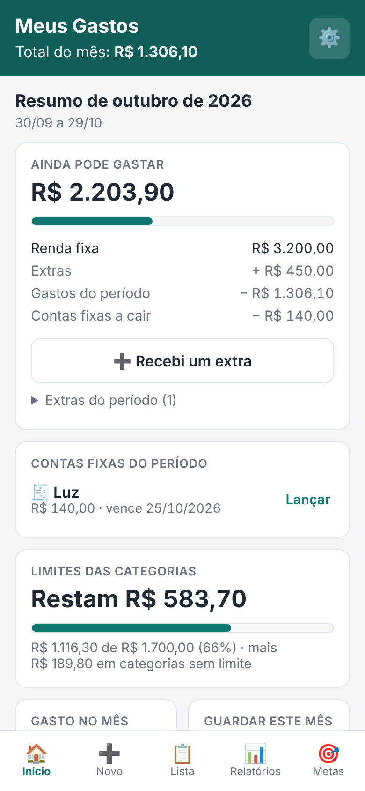
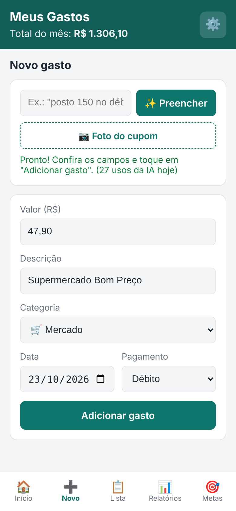
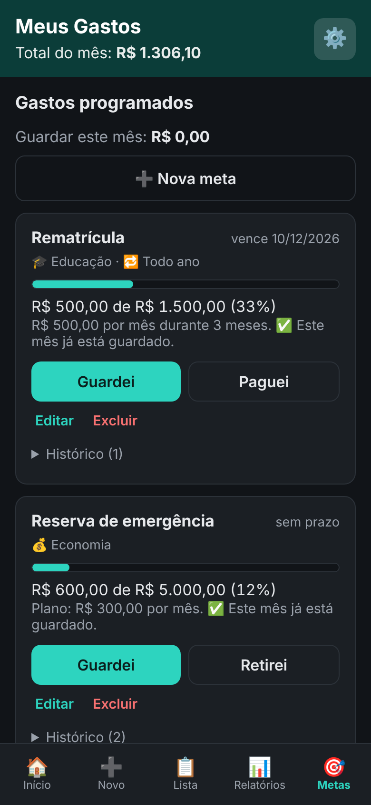

# 💰 Meus Gastos

App de controle de gastos pessoais com IA, instalável no iPhone como **PWA** (sem App Store). Lança um gasto digitando *"posto 150 no débito"* ou fotografando o cupom fiscal. Mostra quanto ainda dá para gastar no mês, acompanha metas e contas fixas, e gera relatórios.

Projeto de estudo e portfólio, feito em JavaScript puro, sem framework.

<p align="center">
  
  
  
</p>

<sub>Prints com dados fictícios.</sub>

## Funcionalidades

- **Lançar gastos com IA:** a IA (Gemini) lê um texto curto ou a foto do cupom e preenche valor, descrição, categoria, data e forma de pagamento. Você confere antes de salvar.
- **"Ainda pode gastar":** renda fixa + extras − gastos − contas fixas a vencer − quanto guardar para as metas.
- **Mês pelo dia do salário:** com pagamento no dia 30, o "mês" vai de 30 a 29.
- **Orçamento por categoria,** com alertas em 80% e 100% do limite.
- **Relatórios:** gráfico por categoria e dos últimos 6 meses (Chart.js), com dicas escritas pela IA.
- **Contas fixas:** lançamento automático (valor fixo) ou com confirmação (valor que muda, como a luz).
- **Metas:** contas a pagar com data (rematrícula, IPVA), com o cálculo de quanto guardar por mês e o botão "Paguei", que vira gasto; e metas de economia com "Retirei".
- **Exportar em CSV,** no padrão do Excel brasileiro.
- **Funciona offline** para abrir (service worker) e tem **modo escuro** automático.

## Tecnologias

| Parte | Tecnologia |
|---|---|
| Interface | HTML, CSS e JavaScript puro (sem framework) |
| Banco e login | [Supabase](https://supabase.com) (PostgreSQL + Auth) |
| Servidor da IA | Supabase Edge Function (Deno/TypeScript) |
| IA | Google Gemini (`gemini-3.5-flash-lite`) |
| Gráficos | Chart.js 4.5.1 |
| Hospedagem | Vercel (deploy automático a cada push) |

## Arquitetura

```
 iPhone / navegador (PWA)
   │
   ├── login e dados ──────────────▶  Supabase (PostgreSQL + RLS)
   │                                     ▲
   └── "posto 150" / foto do cupom       │ confere login, conta o limite diário
        └──▶ Edge Function "ler-gasto" ──┘
                 └── chave secreta ──▶ Gemini
```

A chave da IA **nunca** fica no app. Ela é um segredo da Edge Function, que só atende usuários logados e no máximo 30 vezes por dia.

## Destaques técnicos

**Segurança no banco, não só no app**
- **RLS** (Row Level Security) em todas as tabelas: cada pessoa só lê e altera as próprias linhas, mesmo que alguém use a chave pública com código próprio.
- **Chaves estrangeiras compostas** `(categoria_id, user_id)`: o banco exige que o gasto e a categoria tenham o **mesmo dono**. A primeira versão usava uma chave simples, e os testes mostraram que um usuário conseguia ligar um gasto a uma categoria de outra pessoa. A ligação composta resolveu.
- **Regras `CHECK` e `UNIQUE`:** valor positivo, saldo de meta nunca negativo, e a mesma conta fixa nunca é lançada duas vezes no mesmo mês, mesmo com dois aparelhos abertos.

**Integridade dos dados**
- Dinheiro guardado em **centavos (inteiros)**, para evitar o erro clássico do `0.1 + 0.2` do JavaScript.
- O **"Paguei"** é uma função do banco que roda numa **transação**: lança o gasto, encerra a meta e cria a próxima (se for recorrente). Ou tudo acontece, ou nada.
- Um **gatilho** recalcula o total guardado de cada meta sempre que um depósito entra ou sai.

**A IA interpreta, o código decide**
- A resposta da IA segue um **JSON Schema**, e mesmo assim é conferida no servidor: categoria inexistente vira "Outros", data impossível vira hoje, valor absurdo é descartado.
- Nas dicas do mês, o app calcula **todos os números**, e a IA só escreve o texto.

**Testes**
- SQL testado num PostgreSQL local: RLS entre dois usuários, regras, transações, migrações rodando duas vezes.
- Edge Function testada com o Supabase e o Gemini simulados (44 casos).
- Telas testadas com Playwright: 115 verificações em 320 e 390 px, nos temas claro e escuro.

## Estrutura

```
meus-gastos/
├── index.html, css/, js/       → o app (cada tela em um arquivo .js)
├── sw.js, manifest.webmanifest → PWA
├── sql/                        → banco, em 5 migrações
├── supabase/functions/         → Edge Function da IA
└── GUIA-ETAPA*.md              → passo a passo de cada etapa
```

As decisões de cada parte estão explicadas em detalhes no [README técnico](meus-gastos/README.md).

## Como rodar o seu

1. Crie um projeto no Supabase e rode os arquivos de `meus-gastos/sql/` em ordem, no SQL Editor.
2. Coloque a URL e a **publishable key** do seu projeto em `meus-gastos/js/config.js`.
3. Publique a Edge Function `ler-gasto` e cadastre o segredo `GEMINI_API_KEY`.
4. Publique a pasta `meus-gastos/` na Vercel (Root Directory = `meus-gastos`).

Os guias `GUIA-ETAPA2.md` a `GUIA-ETAPA5.md` têm o passo a passo completo.

---

Feito por **Cristian Jeronimo**, estudante de Ciência da Computação (UNIS, Varginha/MG). Desenvolvido com apoio de IA (Claude) para explicações, revisão de código e testes.
